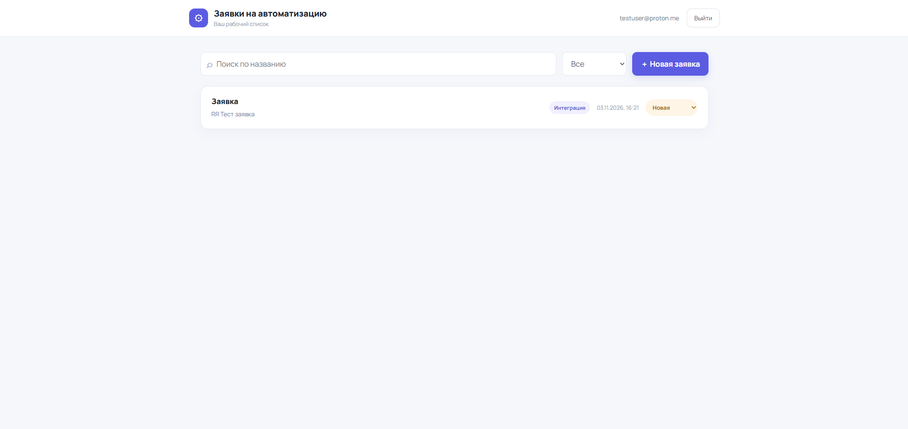
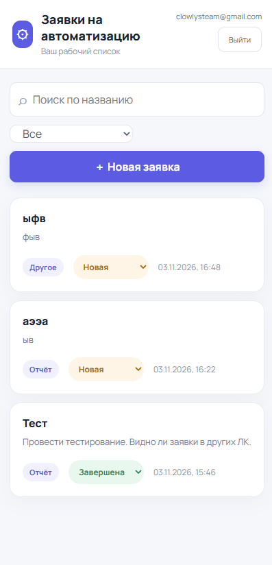
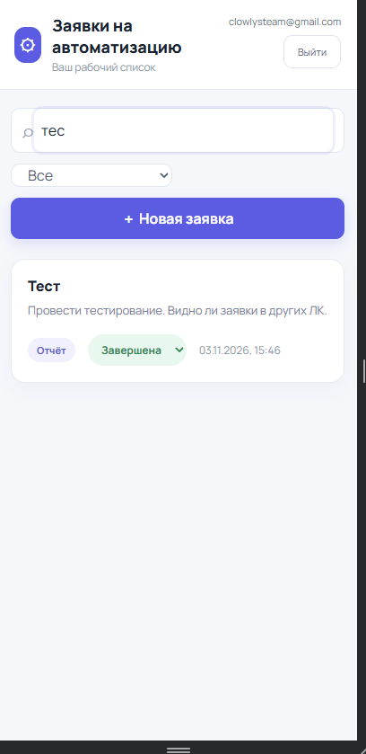
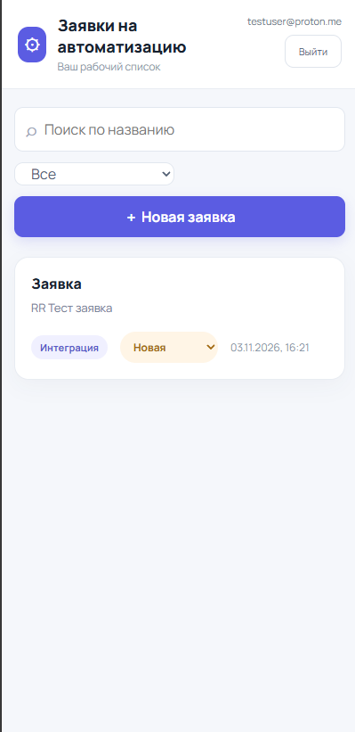
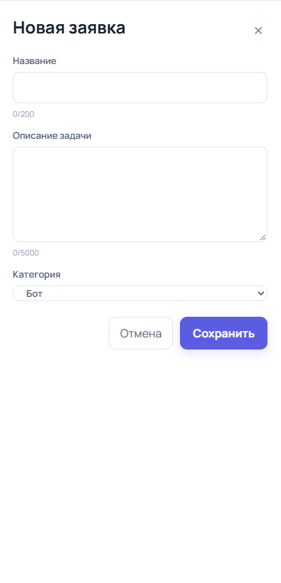
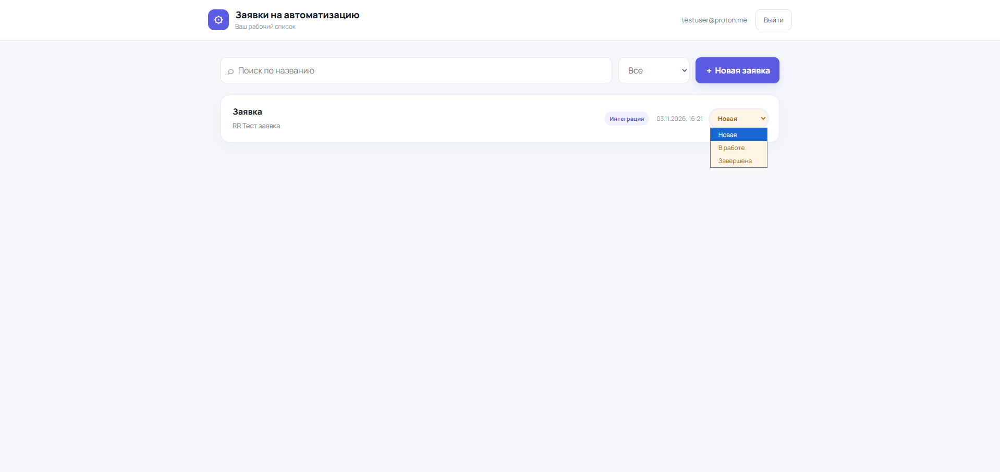
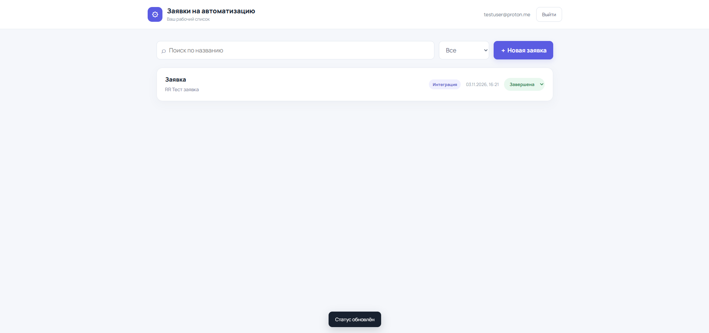

# Заявки на автоматизацию

> **Онлайн-демо:** [https://1wm9k.github.io/automation-requests/](https://1wm9k.github.io/automation-requests/)  
> Тестовое задание для компании LD LATTE (вакансия «Специалист по автоматизации»).



Веб-сервис для создания и отслеживания внутренних заявок команды на автоматизацию. Работает на клиенте (Vite + React + TypeScript + Tailwind CSS) и Supabase (Auth, Postgres, Row Level Security). Хостинг — GitHub Pages.

---

## Ключевые решения и безопасность

1. **Row Level Security (RLS) в Postgres:**
   - Доступ на уровне строк включён на таблице `public.tickets`.
   - Политики `SELECT`, `INSERT`, `UPDATE`, `DELETE` разрешают операции только для записей, где `user_id = auth.uid()`.
   - Защита `WITH CHECK (user_id = auth.uid())` на уровне INSERT/UPDATE исключает подмену владельца.
   - Права у роли `anon` отозваны (`revoke all on public.tickets from anon`).
2. **Неизменяемость полей и целостность:**
   - Поля `user_id` и `created_at` защищены триггером `set_updated_at` (нельзя перезаписать при UPDATE).
   - CHECK-ограничения длины названия (1–200) и описания (1–5000), а также допустимых категорий и статусов.
3. **Защита от дублей и двойных нажатий:**
   - Идемпотентность создания: клиент генерирует UUID (`crypto.randomUUID()`) при открытии модального окна; повторный запрос с тем же ID перехватывается с сообщением «Заявка уже сохранена».
   - Блокировка кнопок и форма во время сетевого запроса (`disabled={busy}`, `saveRef.current`).
4. **Поиск и фильтрация:**
   - Запросы к Supabase: `ilike` с обязательным экранированием спецсимволов `%` и `_`, `eq` по статусу.
   - Debounce ввода ~300 мс.
   - Защита от race condition: инкрементный ID запроса (`request.current`) отсекает устаревшие ответы сети.
5. **Адаптивность:**
   - Полнофункциональный интерфейс на экранах от 320 px (мобильный) до 1920 px (десктоп).
   - Быстрая смена статуса заявки прямо из карточки.

---

## Интерфейс

| Экран / Действие | Скриншот |
| :--- | :--- |
| **Мобильный список заявок** |  |
| **Поиск с debounce и фильтрация** |  |
| **Изоляция данных между аккаунтами (RLS)** |  |
| **Форма создания заявки** |  |
| **Быстрая смена статуса из карточки** |  |
| **Подтверждение сохранения статуса** |  |

---

## Запуск проекта

### 1. Установка зависимостей
```bash
npm install
```

### 2. Настройка переменных окружения
Создайте `.env.local` на основе `.env.example`:
```bash
cp .env.example .env.local
```
Укажите параметры вашего проекта Supabase:
```env
VITE_SUPABASE_URL=https://<your-project>.supabase.co
VITE_SUPABASE_ANON_KEY=<your-anon-key>
```
*(В клиентский код попадает только публичный `anon key`, `service_role key` не используется и не хранится в репозитории).*

### 3. Локальный запуск
```bash
npm run dev
```

---

## Проверки и тесты

```bash
# Проверка типов и сборка
npm run build

# Линтер (0 ошибок, 0 предупреждений)
npm run lint

# Unit-тесты валидации email (vitest)
npm run test

# Интеграционная проверка 9 правил RLS в Supabase
node --env-file=.env.local scripts/verify-rls.mjs
```

Подробнее о схеме базы данных и настройке Auth см. в [docs/SUPABASE_SETUP.md](docs/SUPABASE_SETUP.md).
